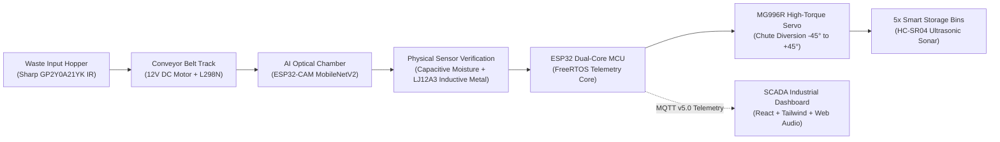

# SMART WASTE SEGREGATION SYSTEM USING IoT & AUTOMATION (ECO-SORT AIoT)

> **B.Tech Capstone Engineering Prototype & Academic Exhibition Project**  
> *Autonomous Multi-Modal Waste Segregation SCADA System Powered by Edge AI, Multi-Sensor Fusion, and IoT Telemetry.*

[](https://react.dev/)
[](https://tailwindcss.com/)
[](https://www.tensorflow.org/lite)
[](https://www.espressif.com/)
[](https://mqtt.org/)

---

## 📌 Project Overview

Rapid municipal solid waste accumulation poses severe ecological hazards when co-mingled in landfills. **ECO-SORT AIoT** is a decentralized, automated sorting station engineered to eliminate hazardous manual handling and prevent recyclable cross-contamination.

By coupling high-speed **MobileNetV2 Edge Computer Vision** with physical cross-validation (**Dielectric Capacitive Moisture Sensing** + **Inductive Eddy-Current Metal Probing**), the system classifies and routes waste into 5 designated streams with high precision.

---

## 🛠️ System Architecture



---

## ⚙️ Hardware Components (Bill of Materials)

| Component | Model / Specification | Purpose |
|---|---|---|
| **Microcontroller** | ESP32-WROOM-32D (240MHz Dual-Core) | Master RTOS task scheduling, sensor polling & MQTT |
| **Edge AI Camera** | ESP32-CAM (OV2640 2MP + 4MB PSRAM) | Optical inspection chamber frame capture & inference |
| **Intake Sensor** | Sharp GP2Y0A21YK IR Proximity | Detects incoming waste at intake hopper to start conveyor |
| **Metal Sensor** | LJ12A3-4-Z/BX Inductive Proximity | Detects eddy currents in aluminum cans and steel |
| **Moisture Sensor**| Capacitive Soil Moisture Sensor v1.2 | Measures dielectric water content for organic separation |
| **Bin Depth Array**| HC-SR04 Ultrasonic Sonar Sensors (x5) | Continuous level calculation and overflow prevention |
| **Sorting Actuator**| MG996R High-Torque Metal Gear Servo | Rapid chute alignment (-45° to +45° within 200ms) |
| **Conveyor Motor** | 12V DC Geared Motor + L298N H-Bridge | Conveyor belt variable speed regulation |

---

## 🚀 Key Software Modules

1. **SCADA Dashboard**: Industrial cyber-dark UI with live telemetry readouts, KPI cards, and hourly waste throughput charts.
2. **Digital Twin Simulator**: Real-time kinematics simulation of the 7-stage automated sorting process with animated conveyor and rotating servo gate.
3. **AI Waste Vision Module**: Interactive visual classifier with multi-sensor cross-validation and pre-loaded academic test samples.
4. **Smart Bins Monitoring**: 5 multi-chute containers with ultrasonic depth measurement ($cm$) converted to fill percentage, featuring 80% warning alerts and 100% capacity interlocks.
5. **IoT Sensor Panel**: Real-time jittering telemetry waveforms and interactive diagnostic testing pins.
6. **Automation & Control Console**: Mode toggles (Auto / Manual Override), manual servo angle positioner, and Emergency Stop (E-STOP).
7. **ESG Environmental Analytics**: Real-time carbon emissions offset calculation, plastic diversion tracking, and a circular sustainability score.
8. **Academic Viva Voce Guide**: Built-in faculty defense prep with 5 core questions and technical answers for exhibition evaluation.
9. **Engineering Audit Report**: One-click printable and downloadable audit dossier with verification checksums.

---

## 💻 Quick Start & Local Setup

### Prerequisites
- [Node.js (v18 or higher)](https://nodejs.org/)
- npm / pnpm

### Installation
```bash
# 1. Clone repository
git clone https://github.com/your-username/smart-waste-segregation-system.git
cd smart-waste-segregation-system

# 2. Install dependencies
npm install

# 3. Launch local development server
npm run dev
```

Visit **`http://localhost:3000`** in your browser.

### Production Build
```bash
npm run build
npm run preview
```

---

## 📊 Ultrasonic Sonar Formula Logic

Container depth is calibrated to $60\text{ cm}$:
$$\text{Fill Percentage} = \left(\frac{60\text{ cm} - \text{Distance}_{\text{HC-SR04}}}{60\text{ cm}}\right) \times 100$$
- If $\text{Fill} \ge 80\% \rightarrow \textbf{WARNING}$ state triggered.
- If $\text{Fill} \ge 100\% \rightarrow \textbf{CRITICAL FULL}$ interlock halts feeder gate.

---

## 📜 License & Academic Attribution
Developed as an engineering capstone prototype for undergraduate evaluation and exhibition demonstration. Licensed under the MIT License.
